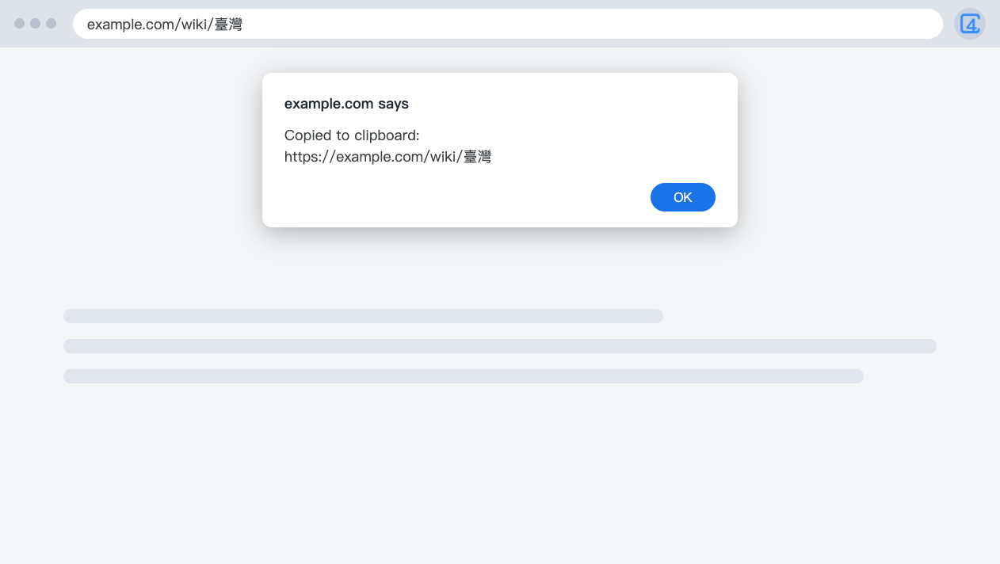

  

<h1 align="center">4cUrls Lite</h1>

  <b>Copy URLs you can read.</b> 
  A small Chrome extension that keeps Chinese URLs readable, and changes nothing else.

  English · <a href="README.zh-TW.md">繁體中文</a>

  

---

## What it is

Copy a Chinese URL from Chrome and paste it somewhere else, and you get a long run of percent signs. Click the 4cUrls Lite icon instead, and what you paste is text you can read.

## Features

- **Readable Chinese URLs.** What you paste is text you can read.
- **The address stays as it is.** Parameters aren't removed, and the page isn't changed.
- **English and Traditional Chinese.** It follows your browser's language.

Want tracking parameters removed and short YouTube links too? Try the full version, [4cUrls](https://github.com/xxxxDev/4curls).

## Install

Install from the [Chrome Web Store](https://chromewebstore.google.com/detail/aaaknjoalhfjdacoicpibhaeicnnfnpb).

To load it yourself, download the zip from the [latest release](https://github.com/xxxxDev/4curls-lite/releases/latest) and unzip it, or clone this repository. Open `chrome://extensions`, turn on **Developer mode**, choose **Load unpacked** and select the unzipped folder. In a clone, select the `extension` folder.

## Use it

1. Open the page you want to share.
2. Click the 4cUrls Lite icon.
3. When the message appears, paste the URL wherever you need it.

The browser may ask once per site for permission to use the clipboard.

## Limits

- **Encoded characters that carry meaning stay encoded.** `%26` stays as it is, because a real `&` would change where the link goes. Spaces stay as `%20`.
- **It doesn't run on browser pages.** `chrome://` pages and the Chrome Web Store don't allow extensions to run.

## Privacy

4cUrls Lite has no server and no analytics. It reads the address of the current page inside your browser, and it doesn't store it or send it anywhere. See [SECURITY.md](SECURITY.md).

## License

The code is under the [MIT License](LICENSE). The icon isn't: see [BRAND.md](BRAND.md).

Made by [V-AX](https://v-ax.com).
