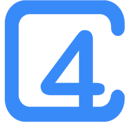
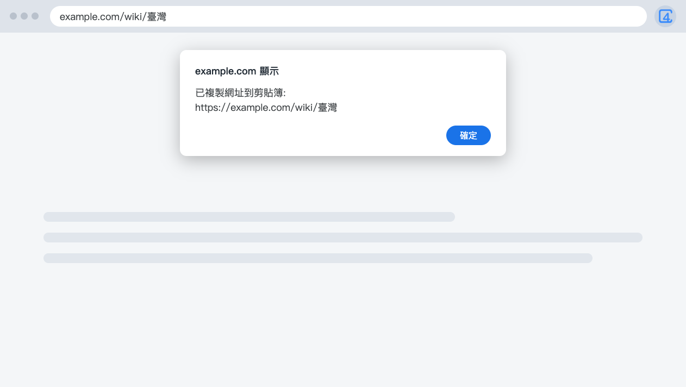

  

<h1 align="center">4cUrls Lite</h1>

  <b>複製看得懂的網址。</b> 
  一個小小的 Chrome 擴充功能：中文網址保持好讀，其他都不動。

  <a href="README.md">English</a> · 繁體中文

  

---

## 這是什麼

從 Chrome 複製中文網址再貼到別處，會變成一長串百分比符號。改按 4cUrls Lite 的圖示，貼上的就是看得懂的文字。

## 功能

- **中文網址好讀。** 貼上的是看得懂的文字。
- **網址保持原樣。** 不拿掉參數，也不改動網頁。
- **英文和繁體中文。** 依瀏覽器語言顯示。

想一併拿掉追蹤參數、把 YouTube 轉成短網址？可以試試完整版 [4cUrls](https://github.com/xxxxDev/4curls)。

## 安裝

從 [Chrome 線上應用程式商店](https://chromewebstore.google.com/detail/aaaknjoalhfjdacoicpibhaeicnnfnpb)安裝。

想自己載入，可從[最新版本](https://github.com/xxxxDev/4curls-lite/releases/latest)下載 zip 解壓縮，或複製這個 repo。打開 `chrome://extensions`，開啟**開發人員模式**，選**載入未封裝項目**，再選解壓縮後的資料夾。複製 repo 的話，選 `extension` 資料夾。

## 使用方式

1. 打開想分享的網頁。
2. 點 4cUrls Lite 的圖示。
3. 看到提示後，到要用的地方貼上。

瀏覽器可能會針對每個網站詢問一次是否允許使用剪貼簿。

## 限制

- **有意義的編碼字元會保留。** `%26` 維持原樣，因為換成 `&` 會改變連結的去向。空格維持 `%20`。
- **瀏覽器自己的頁面不會動作。** `chrome://` 和 Chrome 線上應用程式商店不允許擴充功能執行。

## 隱私與權限

4cUrls Lite 沒有伺服器，也沒有使用分析。它只在瀏覽器裡讀取目前網頁的網址，不會儲存，也不會傳到任何地方。它會在你開啟的網頁上執行一小段程式，而且只在你按下圖示後才寫入剪貼簿。詳見 [SECURITY.md](SECURITY.md)。

隱私相關問題，請寄信到 [support@v-ax.com](mailto:support@v-ax.com)。

## 參與貢獻

想回報問題或提出修改，見 [CONTRIBUTING.md](CONTRIBUTING.md)。

## 授權

程式碼以 [MIT License](LICENSE) 釋出。圖示不在此授權內，見 [BRAND.md](BRAND.md)。

4cUrls Lite 是獨立專案，並非由 Google 製作，也與其沒有關係或背書。Chrome 是 Google LLC 的商標。

由 [V-AX](https://v-ax.com) 製作。
